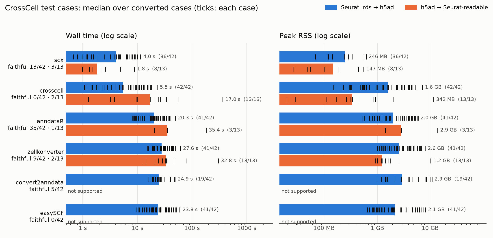
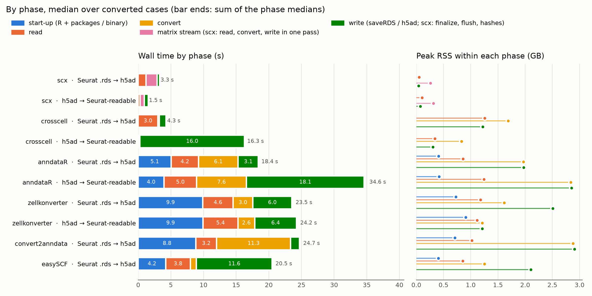
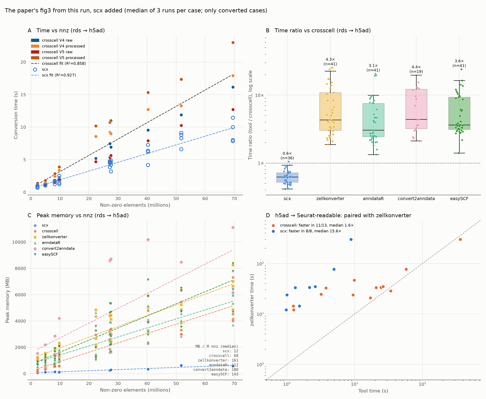
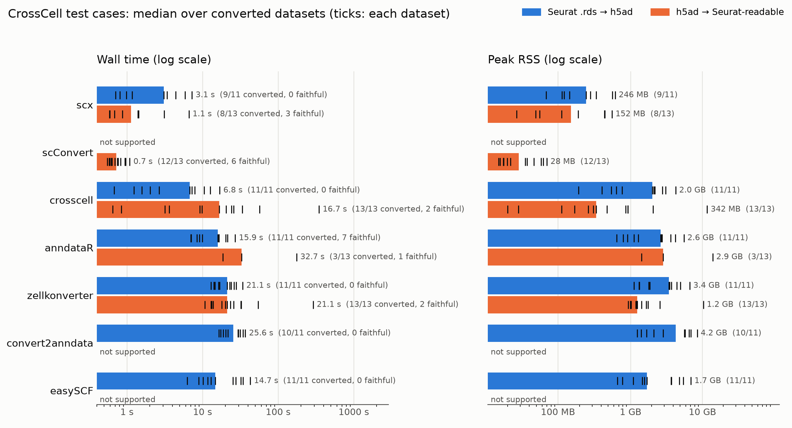
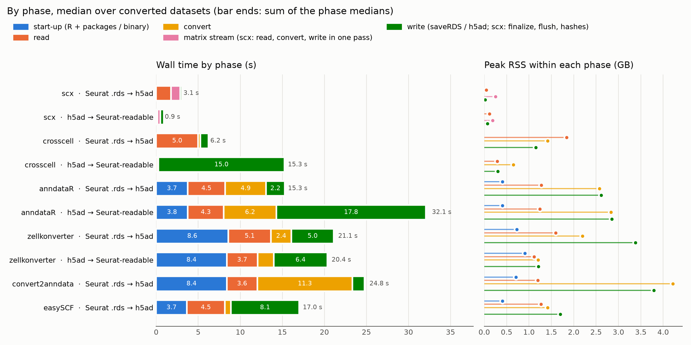
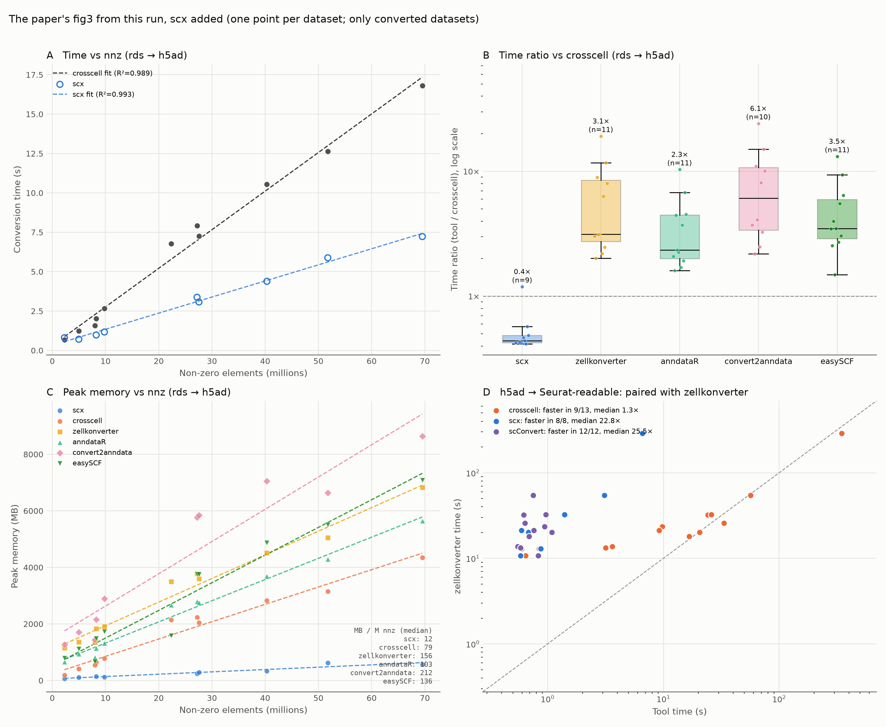

```{python}
# Everything below is rebuilt from results.tsv (pipeline output, copied here), so
# label edits in modules/report.py show up without rerunning the benchmark.
# tables.md (paper's checks) comes from the pipeline as is: it needs the
# paper-fidelity JSONs, which results.tsv does not carry.
import csv, json, sys
from collections import Counter, defaultdict
from pathlib import Path
from IPython.display import Markdown

sys.path.insert(0, str(Path("../modules").resolve()))
import report as R

rows = {}
for r in csv.DictReader(open("results.tsv"), delimiter="\t"):
    for k in ("conversion_time_seconds", "peak_memory_mb"):
        r[k] = float(r[k]) if r[k] else None
    r["phases"] = json.loads(r["phases"] or "{}")
    rows[(r["test_id"], r["tool"])] = r
R.write_figures(rows, Path("."))
ds_rows = R.by_dataset(rows)

def md_table(head, body):
    return "\n".join(["| " + " | ".join(head) + " |", "|" + "---|" * len(head)]
                     + ["| " + " | ".join(map(str, b)) + " |" for b in body])
```

## Headline

Converted = every run exited 0. Faithful = passed every property of our check (names, obs/var
columns, matrices). "By dataset" counts each dataset once: the 42 rds cases are 11 datasets in up
to 4 variants (v4/v5 × raw/processed); a dataset is faithful only if every variant is.

```{python}
def counts(rs):
    c = defaultdict(lambda: [0, 0, 0])  # n, converted, faithful
    for (case, tool), r in rs.items():
        if case == "type_test":
            continue
        x = c[(r["direction"], tool)]
        x[0] += 1; x[1] += r["status"] == "success"; x[2] += r.get("check") == "valid"
    return c

cc, cd = counts(rows), counts(ds_rows)
out = []
for d, label in R.DIRS.items():
    body = [[t, f"{cc[(d, t)][1]}/{cc[(d, t)][0]}", f"{cc[(d, t)][2]}/{cc[(d, t)][0]}",
             f"{cd[(d, t)][1]}/{cd[(d, t)][0]}", f"{cd[(d, t)][2]}/{cd[(d, t)][0]}"]
            for t in R.TOOLS if (d, t) in cc]
    out += [f"**{label}**", "",
            md_table(["tool", "converted (cases)", "faithful (cases)", "converted (datasets)", "faithful (datasets)"], body), ""]
Markdown("\n".join(out))
```

## What fails

Cases failing at least one property, by kind of property (a case can count in several).

```{python}
def kind(p):
    return "names" if p in ("obs_names", "var_names") else p.split("/")[0]

body = []
for d in R.DIRS:
    for t in R.TOOLS:
        rs = [r for (c, tt), r in rows.items() if tt == t and r["direction"] == d and c != "type_test"
              and r["status"] == "success"]
        if not rs:
            continue
        k = Counter(x for r in rs for x in {kind(p) for p in r["failed"].split(",") if p})
        body.append([t, R.DIRS[d], len(rs)] + [k.get(x, 0) for x in ("names", "obs", "var", "matrix")])
Markdown(md_table(["tool", "direction", "converted", "names", "obs", "var", "matrix"], body))
```

Conversions that did not finish (exit ≠ 0 or timeout), with the tool's last error line:

```{python}
body = [[t, r["direction"], c, r["error"][:140].replace("|", "/")]
        for (c, t), r in sorted(rows.items(), key=lambda kv: (kv[0][1], kv[0][0]))
        if r["status"] != "success" and c != "type_test"]
Markdown(md_table(["tool", "direction", "case", "error"], body))
```

```{python}
agree = Counter(r["scx_diff_agrees"] for r in rows.values() if r["scx_diff_agrees"])
Markdown(f"`scx diff` agrees with our check on {agree['True']} of {agree['True'] + agree['False']} "
         "checked outputs; it is a second opinion, never the verdict.")
```

## Fidelity failures by category

Share of converted cases failing at least one property of each kind (darker = more). Click a
cell for the cases behind it and the check's own message; "not converted" lists the tool's last
error line. Categories come from the check's message for each failed property.

```{python}
#| output: asis
import html

KINDS = ["not converted", "cell / gene names", "column dropped", "column type changed",
         "column values / NA", "matrix missing", "matrix values"]

def fail_kind(prop, detail):
    if prop in ("obs_names", "var_names"):
        return "cell / gene names"
    if prop.startswith("matrix/"):
        return "matrix missing" if "no output matrix" in detail else "matrix values"
    if "column dropped" in detail:
        return "column dropped"
    if detail.startswith("type "):
        return "column type changed"
    return "column values / NA"

cells = defaultdict(list)  # (tool, direction, kind) -> [(case, property, detail)]
total = Counter()
for (case, tool), r in rows.items():
    if case == "type_test":
        continue
    d = r["direction"]
    if r["status"] != "success":
        cells[(tool, d, "not converted")].append((case, "", r["error"]))
        continue
    total[(tool, d)] += 1
    det = json.loads(r.get("failed_detail") or "{}")
    for p in filter(None, r["failed"].split(",")):
        cells[(tool, d, fail_kind(p, det.get(p, "")))].append((case, p, det.get(p, "")))

data, trs = {}, []
for d, label in R.DIRS.items():
    trs.append(f'<tr><th colspan="{len(KINDS) + 1}" class="dir">{label}</th></tr>')
    for t in R.TOOLS:
        n = total[(t, d)] + len({c for c, _, _ in cells[(t, d, "not converted")]})
        if not n:
            continue
        tds = []
        for k in KINDS:
            hits = cells[(t, d, k)]
            nc = len({c for c, _, _ in hits})
            denom = n if k == "not converted" else max(total[(t, d)], 1)
            frac = nc / denom
            key = f"{t}|{d}|{k}"
            data[key] = hits
            tds.append(f'<td class="hm" data-k="{html.escape(key)}" style="--f:{frac:.3f}" '
                       f'title="{nc}/{denom}">{nc or ""}</td>')
        trs.append(f'<tr><th>{t}</th>{"".join(tds)}</tr>')

head = "".join(f"<th>{k}</th>" for k in KINDS)
print(f"""
<div class="fidwrap"><table class="fid"><thead><tr><th></th>{head}</tr></thead>
<tbody>{"".join(trs)}</tbody></table>
<div id="fidpanel"><em>Click a cell.</em></div></div>
<script>
const FID = {json.dumps(data)};
document.querySelectorAll('td.hm').forEach(td => td.onclick = () => {{
  document.querySelectorAll('td.hm.sel').forEach(x => x.classList.remove('sel'));
  td.classList.add('sel');
  const [t, d, k] = td.dataset.k.split('|'), hits = FID[td.dataset.k] || [];
  const esc = s => s.replace(/[&<>]/g, c => ({{'&':'&amp;','<':'&lt;','>':'&gt;'}}[c]));
  document.getElementById('fidpanel').innerHTML =
    `<h4>${{t}} · ${{d}} · ${{k}} (${{hits.length}})</h4>` + (hits.length ? '<ul>' + hits.map(([c, p, m]) =>
      `<li><b>${{esc(c)}}</b>${{p ? ' <code>' + esc(p) + '</code>' : ''}}<br><span>${{esc(m)}}</span></li>`).join('') + '</ul>' : '<em>none</em>');
}});
</script>
<style>
.fidwrap {{ display: flex; gap: 1.2em; align-items: flex-start; flex-wrap: wrap; }}
table.fid {{ border-collapse: collapse; font-size: 0.85em; }}
table.fid th {{ text-align: left; padding: 3px 6px; font-weight: 500; }}
table.fid thead th {{ writing-mode: vertical-rl; transform: rotate(180deg); vertical-align: bottom; }}
table.fid th.dir {{ padding-top: 0.8em; font-weight: 600; }}
td.hm {{ width: 2.6em; height: 1.9em; text-align: center; cursor: pointer; border: 1px solid #fff;
  background: color-mix(in srgb, #c0392b calc(var(--f) * 100%), #f4f3f0);
  color: color-mix(in srgb, #fff calc(var(--f) * 200% - 60%), #222); }}
td.hm.sel {{ outline: 2px solid #222; }}
#fidpanel {{ flex: 1 1 22em; max-height: 32em; overflow: auto; font-size: 0.85em;
  border-left: 3px solid #ddd; padding-left: 0.8em; }}
#fidpanel span {{ color: #555; word-break: break-word; }}
</style>
""")
```

## Figures

::: {.panel-tabset}
### Per case (as the paper)






### By dataset





:::

## Tables

```{python}
#| output: asis
# demote the files' headings one level under "Tables"
for f in ("tables.md", "tables_by_dataset.md"):
    print("\n".join("#" + l if l.startswith("#") else l for l in Path(f).read_text().splitlines()), "\n")
```
